# Secure-Vault: Automated, Protected Backup Pipeline on AWS

Full write-up: [https://medium.com/@johnoluwaseyi567/secure-vault-building-an-automated-protected-backup-pipeline-on-aws-cf07f116cbf7?sharedUserId=johnoluwaseyi567)

## Overview

Secure-Vault is an automated backup pipeline on AWS. A private application server, with no public IP address, backs up its data to a private S3 bucket every 10 minutes. The server can upload backups but cannot delete them, and every upload automatically creates an audit record in DynamoDB without anyone doing anything by hand.

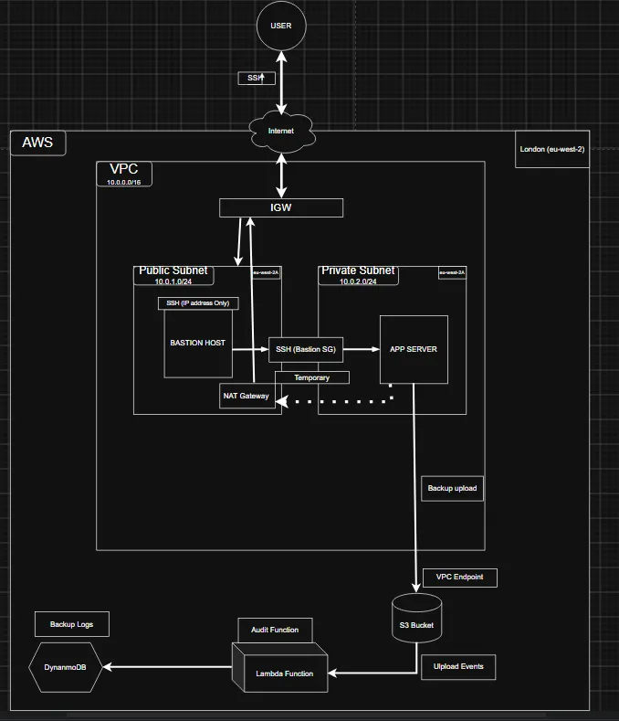

## Architecture

| Component | Details |
|---|---|
| Region | Europe (London), eu-west-2a |
| VPC | secure-vault-VPC, 10.0.0.0/16 |
| Public subnet | 10.0.1.0/24 (bastion host) |
| Private subnet | 10.0.2.0/24 (app server) |
| Bastion host | secure-vault-Bastion, Ubuntu 24.04, t3.micro |
| App server | secure-vault-app, Ubuntu 24.04, t3.micro, no public IP |
| Storage | Private S3 bucket, Block Public Access on |
| Audit trail | S3 event, then Lambda (secure-vault-audit-logger), then DynamoDB (backup-log) |

## Design Principles

- **Least privilege:** the app server can only `s3:PutObject` and the Lambda can only `dynamodb:PutItem`, so a compromised component can do very little.
- **Private infrastructure:** the app server has no public IP and the bucket is not public, and backup traffic reaches S3 through a VPC endpoint instead of the internet.
- **Defense in depth:** private subnet, security groups, IAM policies, a VPC endpoint and Block Public Access all protect the backups, so one failing control does not expose them.
- **Automation over manual work:** cron runs the backup, S3 triggers Lambda, and Lambda writes the audit record, so nothing depends on a person remembering.
- **Cost optimization:** an S3 Gateway endpoint replaces a permanent NAT Gateway, DynamoDB uses on-demand capacity, and Lambda runs only when triggered.

## Why These Choices

### IAM role instead of access keys
Access keys are permanent credentials that sit on the server and can be stolen. An IAM role gives the server temporary credentials that rotate automatically, so there is nothing long-lived to leak. The role also carries only the permission the job needs.

### S3 Gateway endpoint instead of a NAT Gateway
A NAT Gateway bills hourly plus per GB and gives the server a path to the whole internet. A Gateway endpoint is free and reaches only S3, over the AWS network. I used a NAT Gateway temporarily to install the AWS CLI, then deleted it.

## Repo Contents

- `scripts/backup.sh`: backup script run by cron every 10 minutes (it ran from `/usr/local/bin/` on the server)
- `systemd/data-generator.service`: simulated application that writes to `app.log` every 30 seconds
- `policies/private-server-role-policy.json`: EC2 role policy (`s3:PutObject` only)
- `policies/lambda-dynamodb-policy.json`: Lambda policy (`dynamodb:PutItem` only)
- `lambda/lambda_function.py`: the audit logger
- `images/`: screenshots used in this README

## Build Steps

### 1. Network

Everything was created in Europe (London), eu-west-2, in Availability Zone eu-west-2a.

| Resource | Name | Key settings |
|---|---|---|
| VPC | secure-vault-VPC | 10.0.0.0/16, no IPv6 |
| Public subnet | secure-vault-public-subnet | 10.0.1.0/24 |
| Private subnet | secure-vault-private-subnet | 10.0.2.0/24 |
| Public route table | secure-vault-public-rt | Associated with the public subnet |
| Internet gateway | secure-vault-igw | Attached to the VPC |
| Bastion security group | secure-vault-bastion-sg | Inbound: SSH (22) from My IP only |
| App security group | secure-vault-app-sg | Inbound: SSH (22) from the bastion security group only |

Both security groups keep the default outbound rule. The public route table sends `0.0.0.0/0` to the internet gateway. The private subnet has no route to the gateway, so it stays isolated.

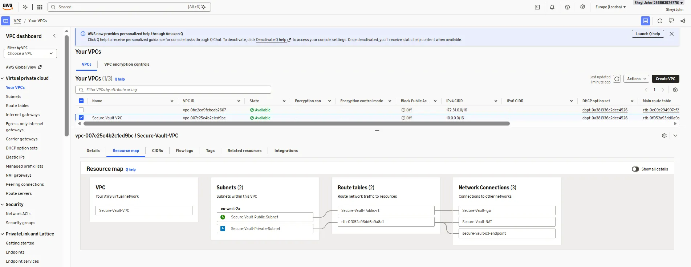

### 2. Servers and SSH access

| | Bastion | App server |
|---|---|---|
| Name | secure-vault-Bastion | secure-vault-app |
| AMI / type | Ubuntu 24.04 LTS, t3.micro | Ubuntu 24.04 LTS, t3.micro |
| Subnet | Public | Private |
| Public IP | Enabled | Disabled |
| Security group | secure-vault-bastion-sg | secure-vault-app-sg |

I reached the app server by hopping through the bastion with SSH agent forwarding, so the private key never sits on the bastion:

```
eval "$(ssh-agent -s)"
ssh-add secure-vault-key.pem
ssh -A ubuntu@<bastion-public-ip>
ssh ubuntu@<app-server-private-ip>
```

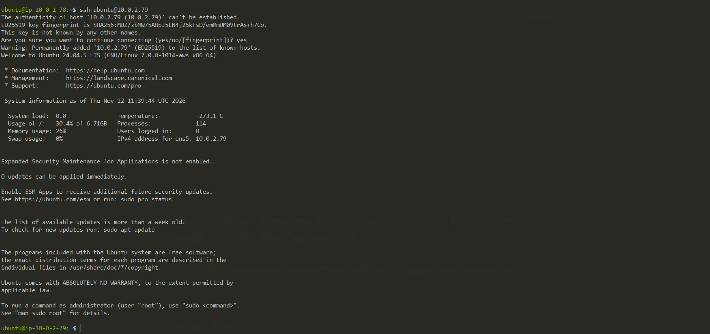

### 3. Temporary NAT Gateway and AWS CLI install

The app server is in a private subnet, so it needed a temporary NAT Gateway to download software. I created `secure-vault-NAT` (zonal, public, in the public subnet, with a new Elastic IP) and added a `0.0.0.0/0` route to it in the private route table, `secure-vault-private-rt`. `curl -m 5 -I https://example.com` returned `HTTP/2 200`, which confirmed it worked. Then I installed AWS CLI v2 on the app server:

```
sudo apt update
sudo apt install -y unzip curl
curl -fSL --retry 3 "https://awscli.amazonaws.com/awscli-exe-linux-x86_64.zip" -o awscliv2.zip
unzip awscliv2.zip
sudo ./aws/install
aws --version
aws configure set region eu-west-2
```

### 4. Private S3 bucket

I created a general-purpose bucket in eu-west-2 with ACLs disabled, Block all public access on, default encryption on, and versioning off for this project.

### 5. IAM policy and role (least privilege)

The policy `secure-vault-s3-put-only` allows one action on one prefix. It cannot read, list or delete anything. See `policies/private-server-role-policy.json`:

```json
{
  "Version": "2012-10-17",
  "Statement": [
    {
      "Effect": "Allow",
      "Action": "s3:PutObject",
      "Resource": "arn:aws:s3:::secure-vault-backups-john-4827/backups/*"
    }
  ]
}
```

I created the role `secure-vault-app-role` (trusted entity: AWS service, use case: EC2), attached the policy, and attached the role to the app server through Actions, Security, Modify IAM role. No access keys are stored on the server.

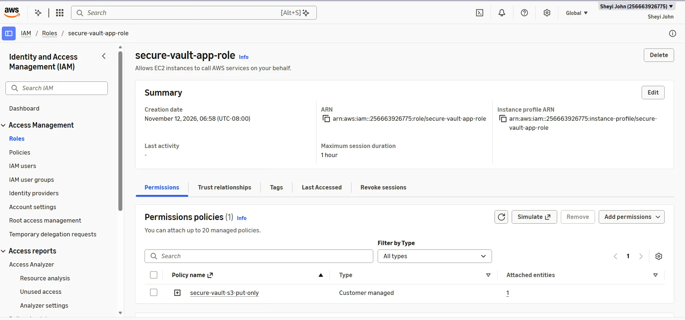

### 6. S3 Gateway VPC endpoint

I created `secure-vault-s3-endpoint` using `com.amazonaws.eu-west-2.s3` (type Gateway) and attached it to the private route table. The private route table then showed three routes: the local route, the temporary NAT route, and the S3 endpoint route.

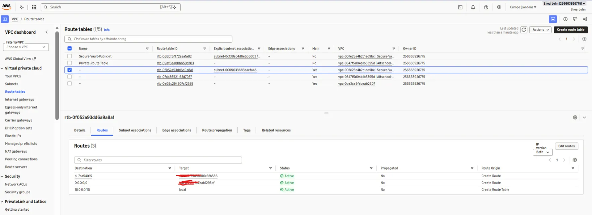

### 7. Proving the restriction

From the app server, an upload works but a delete is denied:

```
echo "test backup" > test.txt
aws s3 cp test.txt s3://secure-vault-backups-john-4827/backups/test.txt
aws s3 rm s3://secure-vault-backups-john-4827/backups/test.txt
```

The upload succeeded and `rm` returned **AccessDenied**, because the role has no `s3:DeleteObject` permission.

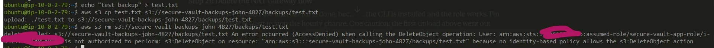

### 8. Deleting the NAT Gateway

I deleted the NAT Gateway and released its Elastic IP. The private route table then showed a blackhole route, which is expected. Afterwards, `curl -m 5 https://example.com` failed, but the S3 upload still worked, because S3 traffic goes through the Gateway endpoint and does not need a NAT.

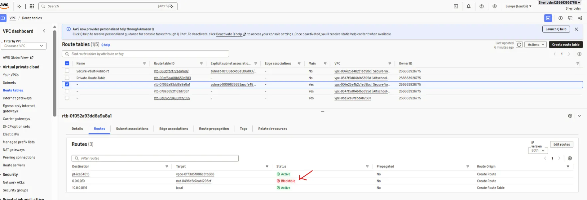

### 9. systemd service

`data-generator.service` appends a timestamped line to `/var/app/data/app.log` every 30 seconds. `Restart=always` with `RestartSec=5` restarts it if it stops, and `WantedBy=multi-user.target` starts it on boot. The `$$` in the unit file is how systemd writes a literal `$`. See `systemd/data-generator.service`.

```
sudo mkdir -p /var/app/data
sudo systemctl daemon-reload
sudo systemctl enable --now data-generator
systemctl status data-generator
tail -n 5 /var/app/data/app.log
```

To prove the restart works, I killed the sleep process with `sudo pkill -f "sleep 30"`, waited 6 seconds, and checked the status again. The service was running again.

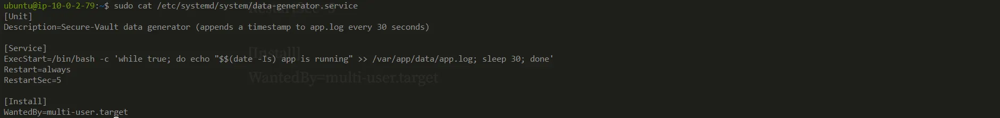

### 10. backup.sh

The script uses `set -euo pipefail`, archives `/var/app/data` as `backup-YYYY-MM-DD-HHMM.tar.gz` in `/tmp`, uploads it to `s3://<bucket>/backups/`, logs success with a timestamp to `/var/log/backup.log`, and deletes the local archive only after a successful upload. A `trap ... ERR` line logs a failure and cleans up the archive if any command fails, so a failed backup never goes unrecorded. See `scripts/backup.sh`.

```
sudo nano /usr/local/bin/backup.sh
sudo chmod +x /usr/local/bin/backup.sh
sudo touch /var/log/backup.log
sudo /usr/local/bin/backup.sh
cat /var/log/backup.log
```

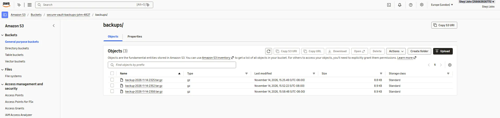

### 11. Cron

Root's crontab runs the script every 10 minutes using an absolute path. I used root's crontab because the script writes to `/var/log`:

```
*/10 * * * * /usr/local/bin/backup.sh
```

I checked it with `sudo crontab -l`, `grep CRON /var/log/syslog | tail -n 5` and `tail -n 5 /var/log/backup.log`.

### 12. DynamoDB and Lambda audit trail

- **DynamoDB table:** `backup-log`, partition key `backup_id` (String), on-demand capacity.
- **Lambda function:** `secure-vault-audit-logger` (Python). Its role has basic execution permissions for CloudWatch Logs plus an inline policy, `secure-vault-DynamoDB-putitem`, that allows only `dynamodb:PutItem` on the table. See `policies/lambda-dynamodb-policy.json` and `lambda/lambda_function.py`.
- **S3 trigger:** event type PUT, prefix `backups/`. PUT was chosen over "all object create events" to keep it narrow.

Every cron backup now creates a record with the backup key, size, upload time and bucket. I confirmed it in the DynamoDB table and in the Lambda's CloudWatch logs.

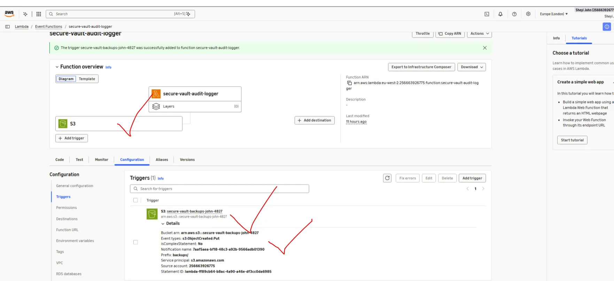
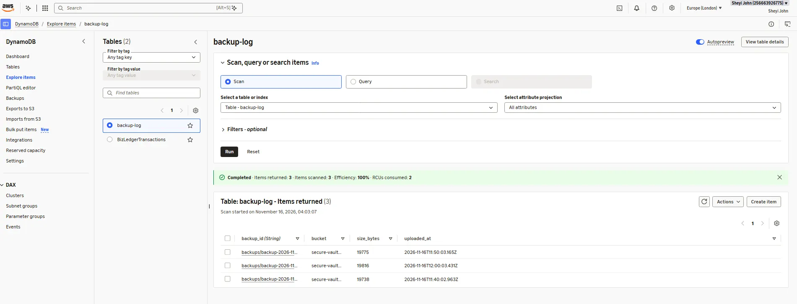

### 13. Budget alert

I created `secure-vault-budget`, a $10 monthly cost budget with an email alert. Billing showed the NAT Gateway, EC2 and VPC (public IPv4 addresses) as the biggest costs, so I deleted the NAT Gateway and its Elastic IP as soon as the CLI was installed.

### 14. Cleanup

I deleted everything in this order: stopped cron (`sudo crontab -r`), terminated both EC2 instances, deleted the Lambda, deleted the DynamoDB table, emptied and deleted the S3 bucket, deleted the endpoint, NAT Gateway, Elastic IPs and VPC with its subnets, route tables, internet gateway and security groups, deleted the IAM roles and policies, and deleted the Lambda's CloudWatch log group. I kept only the budget alert.

## Problems I Hit and How I Fixed Them

| Problem | Cause | Fix |
|---|---|---|
| `ssh-add` said "invalid format" and SSH gave "Permission denied (publickey)" | The `.pem` key was damaged when I copied it into the Vagrant VM | Recreated the file with the full key contents and ran `ssh-add` again |
| `unzip` said "End-of-central-directory signature not found" | The first download used a wrong URL, so curl saved an error page | Re-downloaded with `curl -fSL`, which showed the 404, then used the correct URL |
| "Exec format error" running the AWS CLI | I installed a build for a different CPU architecture | Checked with `uname -m` (x86_64) and installed the matching build |
| "Illegal option -o pipefail" in `backup.sh` | A blank first line pushed `#!/bin/bash` to line 2, so the script ran with `sh` | Found it with `head -n 4 backup.sh \| cat -A` and removed the blank line |
| Two backups with the same filename overwrote each other | The filename only has minute precision, and `PutObject` allows overwriting an existing key | Avoided manual runs near the cron time, and noted S3 versioning as an improvement |
| SSH to the bastion was refused | I had not added the inbound SSH rule for my IP | Added SSH (22) from My IP to the bastion security group |
| Budget reached the alert threshold early | NAT Gateway, EC2 and public IPv4 addresses bill by the hour | Deleted the NAT Gateway and Elastic IP right after setup, then removed everything |

## What I Would Improve in a Real Company

- **S3 Versioning and Object Lock** so backups cannot be overwritten or deleted, even by an admin.
- **Lifecycle rules** to move old backups to cheaper storage and expire them.
- **KMS encryption** with a customer-managed key.
- **Alerts** with CloudWatch and SNS if a backup or the Lambda fails.
- **Session Manager** instead of a bastion host, and separate key pairs per server.
- **Infrastructure as code** so forgotten resources like the NAT Gateway cannot drive up the bill. 
